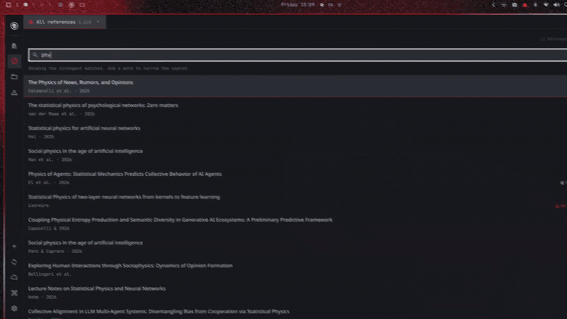

# Omabib

**A fast reference manager for Linux and macOS, made to work with AI agents.**

[](https://github.com/sponsors/atomashevic)

Omabib keeps your papers, PDFs and notes in one quick, keyboard-friendly window. Search as you type, read PDFs in tabs, clip figures into notes, and ask Claude or Codex about the paper in front of you. It's free and open source, and your library stays on your computer.

<!-- Demo video: replace with the new recording. -->
[](docs/demos/demo-1.mp4)

## Install

Open a terminal and paste:

```bash
curl -fsSL https://github.com/atomashevic/omabib/releases/latest/download/get.sh | sh
```

That's it. Open **Omabib** from your applications (Spotlight or Launchpad on a Mac), or run `omabib open`.

- **Runs on** Linux on x86-64 (Ubuntu 22.04 or newer, Debian 12, Fedora, Arch and most other distributions) and macOS 13 or newer on Apple silicon.
- **No admin password or developer tools.** Everything goes into your home folder.
- **Checked before it's installed.** The [install script](scripts/get.sh) downloads the build for your computer and verifies it against the release's checksums.

On a Mac, the first time you open Settings or a chat, macOS may offer to install its command line tools, which include Python. Accept, and you're set.

**To update,** run the same command again. Your library and settings stay as they are.

## Get started

1. **Add a paper.** Click **Add** and paste a DOI, an arXiv ID, a link to the paper, or a BibTeX entry. Check the preview, then press **Import**. Omabib fills in the details, finds the abstract, and downloads an open-access PDF when there is one.
   You can also paste an identifier straight into the search box and press **Enter**.
2. **Bring your existing library.** Export a `.bib` file from Zotero, Mendeley or any other reference manager. In Omabib, press **Ctrl+K** and choose **Import BibTeX file…**.
3. **Find anything.** Just start typing: titles, authors, citation keys, abstracts and your own notes are all searched. Small typos are fine.
4. **Read.** Press **Enter** to open the paper's PDF in a tab, with its notes, abstract and AI summary beside the page.
5. **Organize.** Click **New project** in the sidebar, then **Add to project** on any paper. Each project gets its own notes.

> **On a Mac,** press **⌘** wherever this page says **Ctrl**, and **⌥** for **Alt**.

## What you can do

### Read PDFs comfortably

- Scroll with the wheel, zoom with **Ctrl** + wheel, and pan by dragging with the middle mouse button.
- Keep several papers open in tabs. They're still there, on the same page, next time.
- Find text in a paper with **/**, and jump between matches with **n** and **N**.
- Read at night: **Ctrl+R** draws the page in your theme's colors, and figures and links keep their hue.

### Take notes and clip figures

- Write notes in Markdown, with a live preview and math.
- In a PDF, press **r** and drag over a figure, table or equation. It's saved into a note with its page number.
- Notes can belong to a project, so the same paper can carry different notes for different projects.

### Ask an AI about your papers

- Open a paper and click **Ask Claude** (or **Ask Codex**, if you pick it in **Settings**). The agent reads the paper, its notes and its PDF, and its page references open the page when you click them.
- Select a passage in the PDF and press **c** to ask about just that part.
- It uses your own [Claude Code](https://claude.com/claude-code) or [Codex](https://github.com/openai/codex) login: install one and sign in once. There are no API keys to set up, and Omabib costs nothing extra.
- The agent can read freely, but it asks you before it changes anything in your library.

The rest of Omabib works without any AI account.

### Cite in a click

**Cite** on any paper copies its citation key, a LaTeX `\cite{…}`, a Pandoc or Quarto `[@…]` citation, or the full BibTeX entry. **Copy project bibliography** in **Ctrl+K** copies a whole project's BibTeX.

### Sync between your computers

Keep the same library on your laptop and your desktop. Click **Sync** at the bottom of the sidebar and pick where to keep it: Google Drive, Dropbox, OneDrive, a folder you already sync (Syncthing, Nextcloud…), or other storage. Omabib walks you through the rest and syncs by itself from then on. PDFs and notes come along.

Cloud storage works through [rclone](https://rclone.org), a free sync tool. If you don't have it, install it once: `brew install rclone` on a Mac, or `sudo apt install rclone`, `sudo dnf install rclone` or `sudo pacman -S rclone` on Linux.

### Use your library from other AI apps

Let your agents search your library, read your notes and open PDFs from anywhere:

- **Codex:** in Omabib's **Settings**, click **Connect Codex**.
- **Claude Desktop:** in **Settings**, click **Add Omabib to Claude Desktop**, then restart Claude Desktop.
- **Claude Code:** run `claude mcp add --scope user omabib -- ~/.local/bin/omabib mcp`.

Then ask, for example, "which papers in my library use network models of attitudes?" Agents only add or change things when you ask them to.

## Keyboard shortcuts

Everything has a button too. **Ctrl+K** lists every action, and you can search it.

| In the library | |
|---|---|
| Type, or **Ctrl+F** | search |
| **↑** / **↓** | move through results |
| **Enter** | open the PDF (or the paper's web page) |
| **Tab** | show the paper's details |
| **Ctrl+T** | open the paper in a tab |
| **Ctrl+K** | all actions |
| **Ctrl+P** | switch project |
| **Ctrl+1** … **Ctrl+6** | Overview, AI summary, Notes, Files, BibTeX, Chat |
| **Alt+1** … **Alt+9**, **Ctrl+PgUp** / **Ctrl+PgDn** | switch tabs |
| **Ctrl+W** | close the tab |
| **Esc** | go back, or hide the window |

| In a PDF | |
|---|---|
| Wheel, **j** / **k**, arrows, **Space** | scroll |
| **Ctrl** + wheel, **+** / **−** | zoom |
| **w** / **z** | fit width / fit page |
| Middle-button drag | pan |
| **gg** / **G**, or a number and **G** | first page, last page, or that page |
| **/**, then **n** / **N** | find, next / previous match |
| **r** | clip a region into a note |
| **a** | note on this page |
| **c** | ask the AI about the selection |
| **o** / **]** | contents / side pane |
| **Ctrl+R** | theme or original page colors |

Closing the window keeps Omabib ready in the background, so it opens instantly next time. To show or hide it from anywhere, add a shortcut for `omabib open` in your desktop's keyboard settings; `omabib add` opens straight into the add box.

## Your data

- Your library lives on your computer, in `~/.local/share/omabib/`, along with the PDFs Omabib downloads. PDFs you attach from elsewhere stay where they are.
- Make a backup any time with `omabib backup ~/omabib-backup.db`.
- BibTeX goes in and out freely, so you're never locked in.

## Uninstall

This removes the app and keeps your library. Delete `~/.local/share/omabib` too if you want it gone.

**Linux:**

```bash
omabib-desktop --quit; pkill -f 'omabib serve'
rm -rf ~/.local/lib/omabib ~/.local/share/applications/omabib.desktop ~/.local/share/icons/hicolor/scalable/apps/omabib.svg
rm -f ~/.local/bin/omabib ~/.local/bin/omabib-*
```

**macOS:**

```bash
omabib-desktop --quit; pkill -f 'omabib serve'
rm -rf ~/Applications/Omabib.app
rm -f ~/.local/bin/omabib ~/.local/bin/omabib-*
```

## Troubleshooting

- **`omabib: command not found`.** Open a new terminal. If that doesn't help, add `~/.local/bin` to your `PATH`: put `export PATH="$HOME/.local/bin:$PATH"` at the end of `~/.profile` (on a Mac, `~/.zprofile`).
- **The installer says `python3` is missing.** Omabib's helpers use Python 3, which most Linux desktops include. Install it (`sudo pacman -S python`, `sudo apt install python3` or `sudo dnf install python3`) and run the install command again.
- **The app doesn't open on Linux.** Run `omabib-desktop` in a terminal to see why. On a very minimal system, `ldd ~/.local/lib/omabib/bin/omabib-desktop | grep 'not found'` lists the system libraries it's missing.
- **macOS says Omabib can't be opened.** That happens only to a copy downloaded with a web browser. Run `xattr -dr com.apple.quarantine ~/Applications/Omabib.app`, or install with the command above instead.
- **Chat can't find Claude Code or Codex.** Install it, run `claude` or `codex` once in a terminal to sign in, then choose it in **Settings**.
- **Something else?** [Open an issue](https://github.com/atomashevic/omabib/issues) with what happened and the output of `omabib --version` and `uname -sm`.

## Learn more

- **[User guide](docs/guide.md):** every feature in detail: tabs, the PDF reader, notes, chat, sync, metadata, search and the command line.
- **[Agent guide](skills/omabib/SKILL.md)** and **[API](API.md):** what agents can do with your library, and the JSON operations behind it.
- **[Development](docs/development.md):** building from source, tests and releases.

## License

Omabib is free software under the [GNU Affero General Public License v3.0 or later](LICENSE), Copyright (c) 2026 Omabib contributors. It uses [MuPDF](https://mupdf.com/) (AGPL-3.0) to render PDFs, and [Typst](https://github.com/typst/typst) with the embedded [mitex](https://github.com/mitex-rs/mitex) scope in `src/mitex/` (Apache-2.0) to render math.
